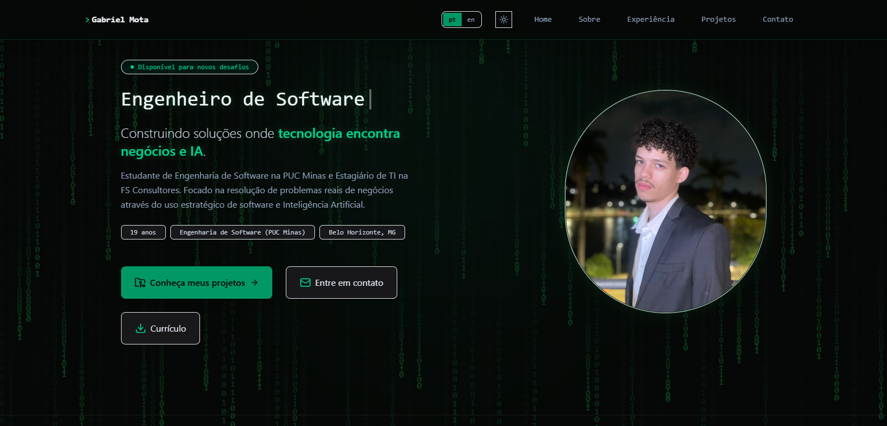
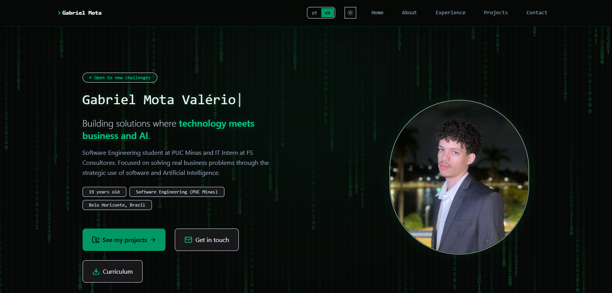
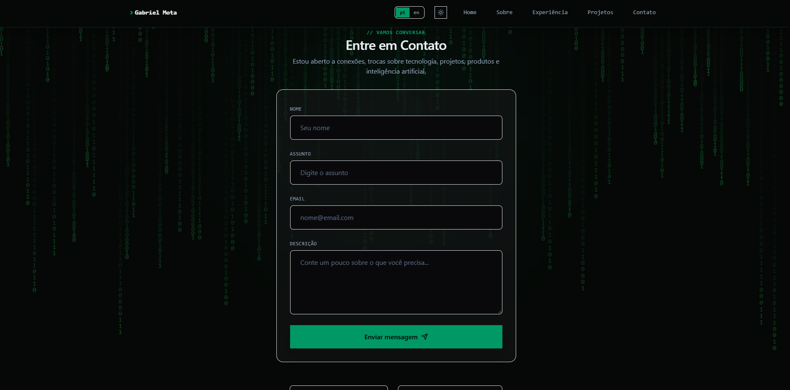
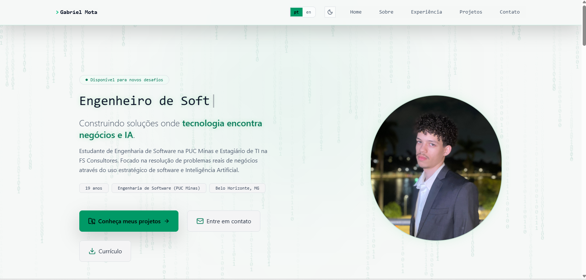

# Portifólio Gabriel Mota
### Projeto desenvolvido em React + vite, em uma página única com adição do GitHub Api, em uma página adicional, projeto no estilo verde com estilo hacker matrix de background
## Principais funcionalidades:

#### Download de Currículo
#### Matrix Background

#### Tradução Português -> Inglês

#### Envio de email usando api do EmailJS

#### Alternar entre temas

